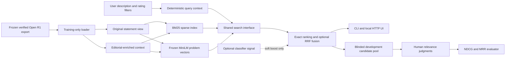

# Algorithm-Aware Semantic Retrieval of Competitive Programming Problems Using Hybrid NLP Models

## Delivered system

CPSS is a local search application for competitive-programming practice. A user
can name an algorithm, describe an approach without naming it, or combine
techniques. The application returns ranked problems, Codeforces source links,
original ratings/tags and exact excerpts from statements or editorials.

The complete frozen corpus has **4,648 problems**. The application deliberately
searches **3,716 training problems** for development and demonstration; 467
validation and 465 test problems are not search candidates. The final classifier
test split has not been evaluated. Searchable coverage is displayed explicitly.

## Architecture

Modules separate loading/context construction, lexical indexing, frozen dense
encoding, ranking, judgment management, evaluation and presentation. The same
`SearchEngine.search` interface serves CLI, UI and evaluation. The application
uses Python's standard HTTP server and local static HTML/CSS/JavaScript; it needs
no MongoDB service, paid API, external LLM, frontend build system or distributed
vector database at search time.

## Corpus preparation and provenance

Open R1 is the provider and Codeforces is the canonical platform identity:
`codeforces:<contest_id>:<index>`. The authoritative export is
`exports/openr1-complete-2026-10-26-v2/`, manifest SHA-256
`2572bdbe3448a230132ce759722aa5353d4f5bb57dc204597a0447e2a82cdc93`.
The original 3,716/467/465 split decisions, contest groups, duplicates, aliases
and upstream holdouts are preserved. The existing corpus verifier is reused.

The corpus contains complete structural problem bundles with statements,
public examples, original tags, editorials and retained accepted solution
sources. This is not a claim of complete private judge tests, manual semantic
review or locally executed solution verification. Some original text contains
upstream OCR artifacts. Source revisions, immutable content versions and hashes
remain recoverable; search does not recollect, relabel or modify the corpus.
See [the collection record](../../../OPENR1_COLLECTION.md) for provider snapshots,
exclusions and the retained upstream license declarations. Those declarations
include an unresolved CC-BY/ODC-By inconsistency, not a newly settled license.

## Classifier milestone and its limits

The historical statement-only TF-IDF + one-vs-rest logistic-regression model
supports 29 observed tags. Its validation micro/macro F1 is **0.549974/0.474177**.
It used validation for hyperparameters and thresholds, making these development
estimates potentially optimistic. An implementation audit reproduced all saved
metrics and found no confirmed classifier/evaluation bug.

Follow-up training-only grouped-CV/OOF selection produced micro/macro F1 of
0.508303/0.455723 for words, 0.502842/0.455898 for words plus characters and
0.474525/0.385231 for frozen MiniLM + logistic regression. Neither alternative
met the predeclared adoption rule. These selection protocols are not identical
to the historical one. The baseline remains a reference, not an oracle.

The source-backed DSU/binary-search review has 48 case pairs with automated
proposals and zero human-reviewed decisions. Missing an upstream tag does not
prove an algorithm unsuitable. Classifier tag prediction and retrieval relevance
are different tasks: classifier F1 cannot substitute for search NDCG or MRR.
The optional classifier boost is separate from original metadata and never
filters candidates. It is disabled in the retrieval comparison.

## Two context layers

**Problem context:** statement-only search uses the exact exported
`input.statement`, already assembled from original title, limits, description,
input/output formats, examples and notes. Editorial-enriched context appends
original upstream tags and original editorial text. Both preserve canonical
identity, source versions, provider revision and view hashes. The latter is
called editorial-enriched context, not generated reasoning or newly verified
algorithm annotations. Accepted code is not an indexed retrieval feature.

**Query context:** a deterministic parser retains the original query, recognizes
known names/aliases (including union find/disjoint set union), extracts rating
bounds and separates explicit names from unknown/inferred information. Unnamed
approaches stay as natural language for dense search; no hidden algorithm label
is fabricated. Existing controlled vocabulary IDs are reused. Broad tag proxies
for names such as Dijkstra remain proxies, not exact problem annotations.

## Retrieval and matching evidence

BM25 uses an in-process sparse matrix with `k1=1.5`, `b=0.75`, Unicode word tokens,
configured stopwords and positive IDF `log(1+(N-df+0.5)/(df+0.5))`. It preserves
term-frequency saturation and document-length normalization, following the
[BM25 framework described by Robertson and Zaragoza](https://www.staff.city.ac.uk/~sbrp622/papers/foundations_bm25_review.pdf)
with the stated positive-IDF variant. These are explicit algorithm/configuration
choices, not learned relevance judgments.

Dense search uses existing pinned `all-MiniLM-L6-v2` weights, revision
`1110a243fdf4706b3f48f1d95db1a4f5529b4d41`, through CPU quantized ONNX inference.
It uses exact cosine similarity on unit-normalized 384-dimensional problem
vectors. Encoder weights are never updated. Training statement vectors are
reused by identity where compatible; enriched vectors were computed locally.
The [pinned model repository](https://huggingface.co/sentence-transformers/all-MiniLM-L6-v2/tree/1110a243fdf4706b3f48f1d95db1a4f5529b4d41)
records the original model assets and Apache-2.0 declaration.

Actual tokenizer profiling preceded encoding. Statement lengths have median 671
and maximum 2,718 content tokens; enriched context has median 1,096 and maximum
7,945. All content is retained in overlapping chunks of 254 tokens plus CLS/SEP,
with overlap 32. Masked token means are pooled by newly covered-token counts and
L2 normalized. Maximum chunks were 13/36, within the configured bound of 64.
This produces one vector per problem and avoids duplicated chunk hits, but
averaging can dilute important evidence and does not model cross-chunk reasoning.

Hybrid retrieval fuses up to 100 candidates from each method using
`sum(1/(60+rank))`. Rankings are deduplicated by canonical identity and ties use
stable IDs. RRF combines ranks rather than incomparable raw BM25/cosine scales;
the formula follows [Cormack, Clarke and Büttcher, SIGIR 2009](https://plg.uwaterloo.ca/~gvcormac/cormacksigir09-rrf.pdf).
This implementation does not claim the paper's effectiveness results apply to
CPSS. Rating and supported observed-tag exclusions are applied before candidate
selection. Optional soft tag/classifier boosts are separate and default off.

Explanations are exact original excerpts with source versions, quote offsets,
matched terms and tag overlap. No solution steps or causal explanations are
generated. BM25 scores, cosine similarity, RRF and independent classifier scores
are not calibrated confidence values.

## Actual evaluation and verification

The fixed development set contains **24 queries**, eight per named/unnamed/
combined category. Top ten candidates from three methods and two views form
**814 unique query–problem judgment pairs**. The review UI/CSV hides originating
method, rank, score and view, and requires grades 2/1/0 plus rationale and human
self-attestation. The raw pool retains rankings for reproducibility.

There are currently **zero human relevance judgments**. NDCG@10 and MRR@10 are
therefore **not available**; no hybrid effectiveness improvement is claimed.
The evaluator is implemented and tested against hand-computed synthetic cases.
It uses only fully judged query pools, exponential graded NDCG gains and grade-2
relevance for MRR. It never treats unjudged documents as irrelevant. Recall is
omitted because exhaustive corpus relevance is unknown.

Actual warm query means on the same 24 queries, with three measured repeats
after one warm-up pass, were:

| Context view | BM25 | Dense | Hybrid |
|---|---:|---:|---:|
| Statement | 9.27 ms | 13.61 ms | 15.35 ms |
| Editorial-enriched | 11.40 ms | 14.55 ms | 17.53 ms |

Loading verified source contexts and indexes took 8.89 seconds; first dense
query initialization took 315 ms. Warm timing includes parsing, query encoding,
ranking and snippets, but excludes loading, HTTP and browser overhead. Query
embeddings are recomputed rather than cached. This is a local descriptive
measurement, with other processes active, not a production benchmark or a
statistical effectiveness result. See [RESULTS.md](RESULTS.md) for details.

**104 tests passed**, including the existing disposable MongoDB integration
suite and 14 new retrieval tests. Dependency checks, source/baseline-preservation
checks, CLI, HTTP and shipped-client-script integration checks passed. Actual
browser visual verification/screenshots are unavailable: the computer-use tool
stopped because it could not verify the browser URL confidently. This limitation
is recorded rather than reported as a successful visual check.

## Limitations and future work

This delivery is a reproducible local demonstrator, with a working relevance
review workflow. It is not a validated algorithm-suitability oracle, a public
deployment or a finished benchmark. Important remaining work is human relevance
adjudication, annotation agreement, source-backed context review and judged
query expansion. Fine-grained hierarchical reranking, calibrated classifier
signals, domain-specific embeddings and alternative chunk aggregation require
controlled future experiments. Preserve the final classifier test until its
evaluation question and configuration are deliberately frozen.

[Runbook and commands](RUNBOOK.md) · [Three-query demonstration](DEMO.md) ·
[Prior classifier comparison](../results-v2.md)
